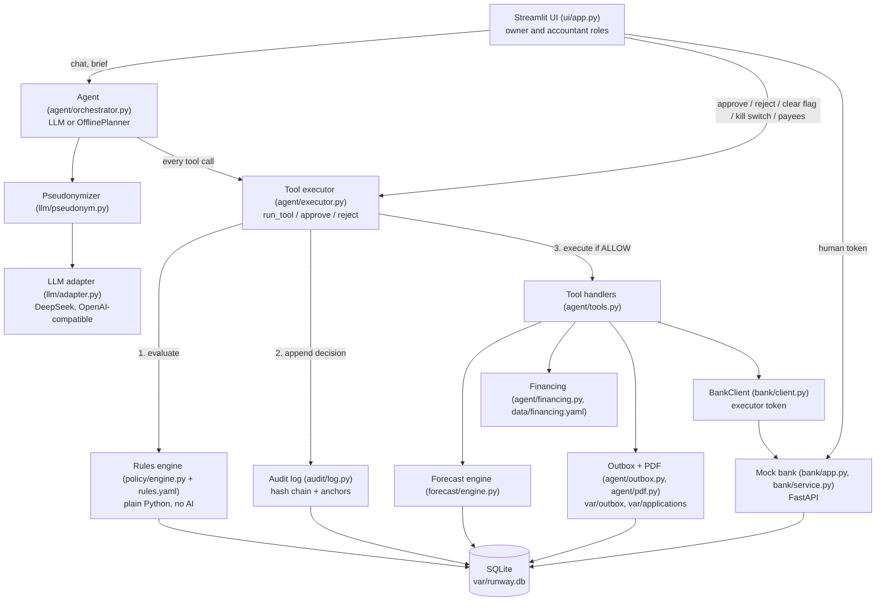

# Runway: system architecture

This document describes what the code in this repository does today. Where the code differs from `docs/SPEC.md` or `docs/CONTRACTS.md`, the difference is stated in a "Spec vs code" note.

Runway is an AI finance officer for a small business (the fictional Lumen Packaging). The agent forecasts cash, chases overdue customers, proposes payment changes and prepares financing applications. Every action it takes passes through a deterministic rules engine and is written to a hash-chained audit log. The agent cannot move money outside those rules.

## 1. Component map



ASCII version:

```
 Owner / accountant (Streamlit UI)
        |  chat                         |  approve / reject / clear flag / kill switch / add payee
        v                               v
 Agent (LLM or offline planner)     agent.executor.approve / reject      bank (human token)
        |  masked text (llm/pseudonym.py)
        |  every tool call
        v
 agent.executor.run_tool
   1. policy.engine.evaluate  -->  ALLOW | NEEDS_APPROVAL(roles) | DENY      (no AI)
   2. audit.log.append        -->  decision is logged before anything happens
   3. ALLOW:          execute handler -> audit EXECUTED / FAILED
      NEEDS_APPROVAL: create ApprovalRequest (waits for humans)
      DENY:           return reason to the agent
        |
        v
 agent/tools.py handlers --> forecast engine, financing, outbox (.eml), PDF
        |
        v  (writes only)
 BankClient (executor token) --> mock bank (FastAPI) --> SQLite
```

All components share one SQLite file (`var/runway.db` by default, set by `RUNWAY_DB`). The mock bank is a separate FastAPI app but reads and writes the same database through `common/db.py`.

## 2. Components and responsibilities

| Module | Responsibility |
|---|---|
| `common/db.py` | SQLModel schema, engine cache, settings helpers (`get_today`, `kill_switch_on`), `account_balance_cents`. Money is always integer cents. |
| `common/config.py` | Country packs (`config/eu.yaml`, `config/cn.yaml`): currency, VAT rate, VAT day, display FX factor. `load_country_pack()` reads `RUNWAY_COUNTRY` (default `eu`). |
| `data/generate.py` | Seeded generator for Lumen Packaging: 12 months of history, open items, settings, CSV exports, attack documents. |
| `forecast/engine.py` | `build_forecast`, `explain_figure`. Pure Python. Every line carries `source_refs`. |
| `agent/financing.py` + `data/financing.yaml` | `compare_financing`, `product_cost`. True cost in integer cents. |
| `policy/engine.py` + `policy/rules.yaml` | `evaluate(session, tool, args, actor, approvals)` returns a `Decision`. Tiers, limits, argument validation, kill switch. |
| `audit/log.py` | `append`, `verify_chain`, `list_entries`. SHA-256 hash chain, head/count anchors in `setting`, SQLite triggers that reject UPDATE and DELETE. |
| `agent/executor.py` | `run_tool`, `approve`, `reject`, `pending_approvals`. The only path from the agent to side effects. |
| `agent/tools.py` | `TOOL_SPECS` (OpenAI function schemas, 15 tools, T0 to T3 only) and `HANDLERS`. Bank writes only via `BankClient` with the executor token. |
| `agent/outbox.py`, `agent/pdf.py` | Test inbox (`OutboxEmail` row plus `var/outbox/MAIL-xxxx.eml`) and the financing application PDF (`var/applications/FIN-xxxx.pdf`). |
| `agent/documents.py` | `ingest_document`, `scan_document`, `wrap_untrusted`. Deterministic injection and business-email-compromise (BEC) scan. |
| `agent/orchestrator.py`, `agent/prompts.py` | `Agent.chat`, `Agent.monday_brief`, the tool loop, system prompt, deterministic jailbreak filter `is_bypass_attempt`. |
| `llm/adapter.py` | `LLMAdapter` (OpenAI SDK, any compatible provider) and `get_adapter()` (falls back to the offline planner). |
| `llm/offline.py` | `OfflinePlanner`: deterministic keyword-routed stand-in for the LLM, same `chat(messages, tools)` interface. |
| `llm/pseudonym.py` | `Pseudonymizer`: reversible masking of names, e-mails and IBANs. |
| `bank/app.py`, `bank/service.py`, `bank/client.py` | Mock bank: bearer-token auth, payee and payment endpoints, idempotency, simulated clock. |
| `ui/app.py`, `ui/helpers.py` | Streamlit UI (see section 8). |

## 3. Data model (`common/db.py`)

All amounts are integer cents (EUR in storage; the CN pack only converts for display).

| Table | Key fields | Purpose |
|---|---|---|
| `account` | `id` (ACC-MAIN), `currency`, `opening_balance_cents` | Bank account. Balance = opening + sum of transactions up to a date. |
| `counterparty` | `id` (CUST-BRIGHTFIELD, SUP-CARTONIA, ...), `kind`, `payment_terms_days`, `email` | Customers, suppliers, landlord, tax office, lender, payroll. |
| `payee` | `id` (PAYEE-CARTONIA, ...), `iban`, `verified`, `created_by` | Who the company may pay. Only humans create or edit rows. |
| `invoice` | `id` (AR-1101, AP-2050), `direction` (AR/AP), `due_date`, `amount_cents`, `status`, `critical`, `document_id` | Receivables (owed to us) and payables (we owe). `critical` marks tax items that must not be rescheduled. |
| `transaction` | `id` (TX-000123), `booking_date`, `amount_cents` (signed), `category`, `invoice_id` | Booked bank history. Source rows for forecast traceability. |
| `payment` | `id` (PAY-0001), `idempotency_key` (unique), `payee_id`, `execute_date`, `status` (scheduled/executed/cancelled), `automatic`, `created_sim_date` | Payments in the mock bank. `automatic` and `created_sim_date` feed the daily caps. |
| `document` | `id` (DOC-0001), `content_text`, `flagged`, `flag_reason`, `cleared` | Incoming invoices and e-mails. Text is untrusted. |
| `approvalrequest` | `id` (APR-0001), `tool_name`, `args_json`, `required_roles_json`, `approvals_json`, `status` | A tool call parked for humans. |
| `outboxemail` | `id` (MAIL-0001), `to`, `kind` (reminder/fraud_alert/notification), `invoice_id`, `sent_at` | Test inbox. |
| `financingapplication` | `id` (FIN-0001), `product_id`, `pdf_path`, `status` | Prepared, never submitted. |
| `auditentry` | `id`, `timestamp`, `actor`, `action`, `args_json`, `args_hash`, `decision`, `reason`, `prev_hash`, `hash` | Hash-chained log. |
| `setting` | `key`, `value` | `today` (simulated clock), `kill_switch`, `country`, `audit_head`, `audit_count`, `owner_email`, and `bank.request.<PAY-id>` (canonical body of each payment request, used by idempotency). |

Canonical IDs used by the demo and tests: account `ACC-MAIN`; customers `CUST-BRIGHTFIELD` (net 75) and `CUST-SMALL-1..6` (net 30); suppliers `SUP-CARTONIA`, `SUP-INKWORKS`, `SUP-VOLTA-ENERGY`, `SUP-SWIFTLOG`; verified payees `PAYEE-CARTONIA`, `-INKWORKS`, `-VOLTA`, `-SWIFTLOG`, `-LANDLORD`, `-TAX`, `-LENDER`, `-PAYROLL`; one unverified `PAYEE-NEWVENDOR`.

Simulated time: `Setting("today")`, default 2026-10-19 (a Monday). Forecast week 1 is 2026-10-19 to 10-25, week 6 is 11-23 to 11-29, week 11 is 12-28 to 2027-01-03. `POST /simulate/advance` moves the clock and books due scheduled payments.

## 4. Request flow of one tool call

Example: the agent calls `schedule_payment` for 950 to a verified payee.

1. **Agent** (`Agent._loop` in `agent/orchestrator.py`). The user message and history are masked by `Pseudonymizer.mask`, so the model sees `<SUPPLIER_2>` and `<IBAN_3>`, not real names. The model replies with a tool call. Its arguments are unmasked with `unmask_obj` and passed to `executor.run_tool(session, name, args, actor="agent")`. The agent object never touches the bank client.
2. **Replay short-circuit** (`executor.run_tool`, `schedule_payment` only). Before the policy runs, the executor computes the idempotency key (`args["idempotency_key"]` or the derived one) and looks for an existing `Payment` with that key. If one exists and the request body matches the stored original (`setting` row `bank.request.<PAY-id>`), the original payment is returned with `idempotent_replay: true`, the audit log gets an `IDEMPOTENT_REPLAY` entry, and nothing else happens. A body mismatch is audited as DENY. This path has no side effects, but it does not consult the kill switch or the other policy rules.
3. **Policy** (`executor.run_tool` calls `policy.engine.evaluate`). The engine loads `policy/rules.yaml` on every call and runs, in order:
   1. tier lookup (unknown tool or T4 gives DENY);
   2. argument screen (`_forbidden`: any key containing `iban`, or named `bank_details` or `account_number`, at any depth, gives DENY);
   3. schema validation (`_validate`: unexpected or missing keys, wrong types, non-positive integers, bad dates, enums);
   4. actor check (`agent`, `owner`, `accountant`, `system`);
   5. kill switch (any tool above T0 gives DENY when `Setting.kill_switch != "off"`);
   6. tool-specific rules (for `schedule_payment`: payee verified, currency matches the account, date not in the past, invoice matches an open AP invoice of that payee and the amount does not exceed it, linked document not flagged-and-uncleared, then the automatic limits);
   7. if approver roles are required, the outcome is NEEDS_APPROVAL unless all required roles are already in `approvals`.
   Any exception inside the engine returns DENY (fail closed).
4. **Audit** (`audit.log.append`). The decision (`ALLOW`, `NEEDS_APPROVAL` or `DENY`) with the full arguments and reason is appended before anything else happens.
5. **Branch**:
   - `DENY`: the agent receives `ToolResult(status="denied", reason=...)`. Nothing else happens.
   - `NEEDS_APPROVAL`: an `ApprovalRequest` row is created (an identical pending request is reused). The agent receives `status="needs_approval"` with the approval id and required roles.
   - `ALLOW`: `_execute` runs the handler from `HANDLERS`.
6. **Executor to bank**. For payments the handler `schedule_payment` in `agent/tools.py` builds a `BankClient` with `RUNWAY_BANK_EXECUTOR_TOKEN` and calls `create_payment`. With no `RUNWAY_BANK_URL` the client runs the bank app in-process (FastAPI `TestClient`); with it set, it uses HTTP. The idempotency key is derived deterministically (`idempotency_key()`: SHA-256 of payee, amount, date, invoice, document) unless the caller supplies one. `automatic=True` is set when the policy tier was T2.
7. **Bank** (`bank/service.create_payment`). Takes the SQLite writer lock (`BEGIN IMMEDIATE`), applies the idempotency rule, then its own checks: payee exists and is verified (422), amount a positive integer, currency matches the account, `execute_date` not before the bank's today, invoice (if given) is an open AP invoice for that payee, document (if given) exists. It stamps `created_sim_date` and stores the canonical request body in `setting` as `bank.request.<PAY-id>`.
8. **Audit again**. `EXECUTED` on success, `FAILED` with the error text otherwise. The agent receives the `ToolResult`, which is masked before going back to the model.

Spec vs code: the spec and contract describe the same flow. One detail not in the spec: step 2 also screens argument keys at any depth for IBAN-like names, and validates every argument against a hard-coded schema table (`_SCHEMAS`) that is separate from `TOOL_SPECS`.

## 5. Approval flow

Triggers: `reschedule_payment` (owner), `prepare_financing_application` (owner; owner and accountant above 5,000), `schedule_payment` outside the automatic limits (owner; owner and accountant above 5,000).

```
agent: run_tool(...)  ->  NEEDS_APPROVAL  ->  ApprovalRequest(status=pending, required_roles=[...])
                                                    |
UI approval queue: owner clicks Approve  ->  executor.approve(session, id, "owner")
   - role not in required_roles           -> audit DENY, nothing recorded
   - role recorded in approvals_json      -> audit APPROVED
   - policy.evaluate(..., approvals=given) is run AGAIN with current database state
        DENY            -> request status "rejected", audit DENY "re-check at approval"
        NEEDS_APPROVAL  -> still waiting for the other role
        ALLOW           -> _execute(actor=<role>, automatic=False) -> status "executed" or "failed"
UI: Reject -> executor.reject -> status "rejected", audit REJECTED
```

The re-check at approval time means a payment cannot be executed after circumstances changed (kill switch switched on, document flagged in the meantime, payee changed). The policy fixes the argument payload at request time: approvers approve exactly the stored `args_json`.

An approved action is executed with `automatic=False`, so it does not count toward the daily automatic caps.

## 6. The five non-negotiable design rules and how the code enforces them

### Rule 1. The AI never does arithmetic

- All numbers are produced by Python: `forecast/engine.py:build_forecast`, `forecast/engine.py:explain_figure`, `agent/financing.py:product_cost` and `compare_financing`, `policy/engine.py:evaluate` (limits).
- `agent/prompts.py:SYSTEM_PROMPT` rule 2 tells the model to quote only tool results.
- `llm/offline.py:OfflinePlanner` builds its sentences only from tool results in the message history (`_reply`, `_financing_args`).
- Enforcement strength: structural for decisions (the model cannot change a limit or a cost), instructional for wording. There is no check that a number in the model's free text matches a tool result. See KNOWN RISKS in `docs/security-self-assessment.md`.

### Rule 2. The AI never holds bank credentials and never calls the bank directly

- Tokens are read from the environment only inside `agent/tools.py:bank_client`, called from the handlers `schedule_payment` and `reschedule_payment`, after the policy has allowed the call.
- `Agent` receives only `ToolResult` objects (`agent/orchestrator.py:_loop`). No token, bank URL or IBAN is part of a result. Handlers return payment rows, which contain `payee_id` but not the IBAN.
- `llm/pseudonym.py:Pseudonymizer.mask` replaces names and any IBAN-shaped string before text reaches the model.
- Test: `tests/test_executor.py::test_tool_specs_expose_no_forbidden_capability`.

### Rule 3. The rules engine is plain code outside the AI

- `policy/engine.py:evaluate` is a normal function using SQLAlchemy queries and `policy/rules.yaml`. No model call.
- It is called on every tool call by `agent/executor.py:run_tool` and again by `agent/executor.py:approve`. `run_tool` is the only entry point used by `Agent._run`.
- It fails closed: an exception, missing config or malformed arguments return DENY (`evaluate`, final `except`; `tests/test_policy.py::test_malformed_policy_fails_closed`).
- It refreshes `today` and `kill_switch` from the database with `populate_existing`, so cached ORM state cannot hide a change (`tests/test_policy.py::test_kill_switch_refreshes_external_change`).

### Rule 4. No tool for adding or changing payee bank details

- `agent/tools.py:TOOL_SPECS` has no payee, IBAN, limit, export or kill-switch tool.
- `policy/rules.yaml` lists `add_payee, update_payee, change_limits, export_data, set_kill_switch` as tier T4; `evaluate` returns DENY for T4 and for any name not in `_SCHEMAS`.
- `policy/engine.py:_forbidden` rejects any argument key that contains `iban` or equals `bank_details` or `account_number`, at any nesting depth.
- Defense in depth at the bank: `bank/app.py:authorize("payees")` returns 403 unless the caller used the human token; `bank/service.create_payment` returns 422 for an unverified payee. The executor token cannot create payees (`tests/test_bank.py::test_auth_scopes`).
- The UI page "Payees (humans only)" is the only place that creates payees, using the human token.

### Rule 5. Every figure traces back to ledger rows

- `forecast/engine.py:ForecastLine.source_refs` lists the `Transaction`, `Invoice` or `Payment` ids behind each line. Recurring estimates cite the transactions they were averaged from.
- `forecast/engine.py:explain_figure` returns the lines plus the actual source rows for any week and field; exposed to the agent as the T1 tool `explain_figure` and in the UI forecast page.
- Test: `tests/test_forecast.py::test_traceability`, `::test_explain_figure`.
- Limit: tracing applies to forecast and cost figures. Free text written by a real LLM is not machine-checked.

## 7. Cross-cutting design

- **Simulated clock**: all date logic uses `common.db.get_today(session)`. Policy, forecast, bank, outbox (`_sim_now`) and reminders agree on one "today".
- **Fail closed**: policy errors become DENY; audit `append` refuses to write if the existing chain does not verify.
- **Concurrency**: the bank and the audit log take the SQLite writer lock before reading ids or the chain head (`BEGIN IMMEDIATE`, or an `INSERT OR IGNORE` on `setting` in `audit.log.append`). `tests/test_audit.py::test_concurrent_append` and `tests/test_bank.py::test_concurrent_duplicate_requests` cover it.
- **Country pack**: currency symbol, VAT rate, VAT day come from `config/<code>.yaml`. See `docs/deployment.md` for the two places the pack is selected.

## 8. UI

`ui/app.py` is the human side. It never grants the agent extra powers: agent chat goes through `Agent`, human actions go through `agent.executor.approve/reject`, `audit.log.append` (with the acting role) and the bank client with the human token. The section list is defined in `SECTIONS`: Onboarding, Monday brief and chat, Forecast, Approval queue, Documents, Payees (humans only), Mock bank, Test inbox, Audit log. Details of the pages are in `docs/demo-script.md`.
