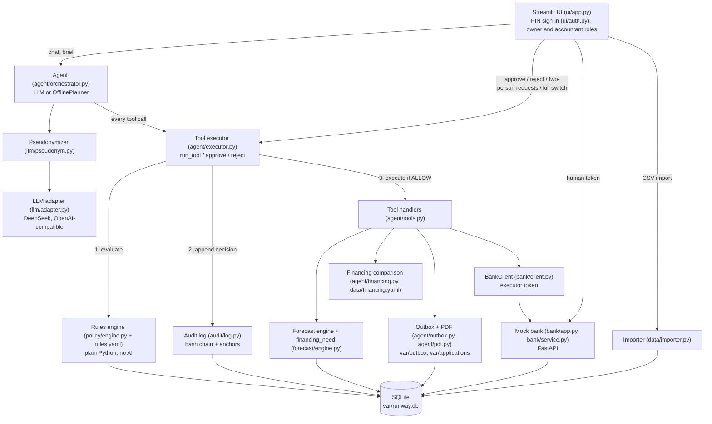

# Runway: system architecture

This document describes what the code in this repository does today. Where the code differs from `docs/SPEC.md` or `docs/CONTRACTS.md`, the difference is stated in a "Spec vs code" note.

Runway is an AI finance officer for a small business (the fictional Lumen Packaging). The agent forecasts cash, chases overdue customers, proposes payment changes and prepares financing applications. Every action it takes passes through a deterministic rules engine and is written to a hash-chained audit log. The agent cannot move money outside those rules.

## 1. Component map



ASCII version:

```
 Owner / accountant (Streamlit UI, PIN sign-in)
        |  chat                         |  approve / reject / clear flag / kill switch / payees / CSV import
        v                               v
 Agent (LLM or offline planner)     agent.executor.approve / reject      bank (human token)
        |  masked text (llm/pseudonym.py); unknown placeholders in tool arguments are rejected
        |  every tool call
        v
 agent.executor.run_tool
   1. policy.engine.evaluate  -->  ALLOW | NEEDS_APPROVAL(roles) | DENY      (no AI)
   2. audit.log.append        -->  decision is logged before anything happens
      (financing tools: omitted amount/needed_by/days_needed are filled from forecast.engine.financing_need first)
   3. ALLOW:          execute handler -> audit EXECUTED / FAILED
      NEEDS_APPROVAL: create ApprovalRequest (waits for humans)
      DENY:           return reason to the agent
        |
        v
 agent/tools.py handlers --> forecast engine, financing, outbox (.eml), PDF
        |
        v  (writes only)
 BankClient (executor token) --> mock bank (FastAPI) --> SQLite
```

All components share one SQLite file (`var/runway.db` by default, set by `RUNWAY_DB`). The mock bank is a separate FastAPI app but reads and writes the same database through `common/db.py`.

## 2. Components and responsibilities

| Module | Responsibility |
|---|---|
| `common/db.py` | SQLModel schema, engine cache, settings helpers (`get_today`, `kill_switch_on`), `account_balance_cents`. Money is always integer cents. |
| `common/config.py` | Country packs (`config/eu.yaml`, `config/cn.yaml`): currency, VAT rate, VAT day, display FX factor. `load_country_pack()` reads `RUNWAY_COUNTRY` (default `eu`). `CountryPack.display(ledger_cents)` converts and formats an amount for people; it is the only conversion in the code. The ledger and the bank stay in the account currency (EUR). |
| `data/generate.py` | Seeded generator for Lumen Packaging: 12 months of history, open items, settings, CSV exports, attack documents. |
| `data/importer.py` | `import_files(...)`: validates a company's CSV exports (trial balance, bank statement, optional open receivables and payables, optional paid invoices and scheduled payments) and rebuilds the database. All-or-nothing: nothing is written if any file fails validation. Imported payees are unverified. |
| `forecast/engine.py` | `build_forecast`, `explain_figure`, `financing_need`. Pure Python. Every line carries `source_refs`. The balance is walked line by line (same-day payments before receipts), and a week is a shortfall when its running balance goes below zero at any point. `financing_need` computes the amount, the needed-by date and the duration of a financing request from that running balance. |
| `agent/financing.py` + `data/financing.yaml` | `compare_financing`, `product_cost`. True cost in integer cents; every option carries its cash arrival date; excluded options carry a reason and their arrival date. |
| `policy/engine.py` + `policy/rules.yaml` | `evaluate(session, tool, args, actor, approvals)` returns a `Decision`. Tiers, limits (including `max_payment_cents`), argument validation, kill switch, invoice overpayment, reschedule and financing-application rules. `rules.yaml` is read once per process (`load_rules` is cached; `reload_rules()` re-reads it). |
| `audit/log.py` | `append`, `verify_chain`, `list_entries`. SHA-256 hash chain, head/count anchors in `setting`, SQLite triggers that reject UPDATE and DELETE. |
| `agent/executor.py` | `run_tool`, `approve(session, id, role, approver_id)`, `reject`, `pending_approvals` (expires stale requests), `request_human_action` (two-person requests to verify a payee, clear a document flag or release a supplier), `clear_document_flag`. The only path from the agent to side effects. |
| `agent/charts.py` | `build_chart`: chart data for the T1 tool `make_chart` (forecast balance or cash flow, receivables by customer or age, payables, monthly transactions, financing costs), computed from the ledger. The model only picks the dataset; the UI draws the chart. |
| `agent/invoices.py` | `find_invoice_refs` (invoice ids and numbers named in a text, checked against the ledger), `invoice_details`, `invoice_pdf` (a copy rendered from the ledger row). Used by the UI's invoice dialog and buttons. |
| `agent/tools.py` | `TOOL_SPECS` (OpenAI function schemas, 17 tools, T0 to T3 only) and `HANDLERS`. Bank writes only via `BankClient` with the executor token. |
| `agent/outbox.py`, `agent/pdf.py` | Test inbox (`OutboxEmail` row plus `var/outbox/MAIL-xxxx.eml`) and the financing application PDF (`var/applications/FIN-xxxx.pdf`). |
| `agent/documents.py` | `ingest_text`, `ingest_file(path, kind, sender, allowed_root)`, `ingest_document` (bytes or text only), `scan_document`, `link_document`, `sanitize_meta`, `wrap_untrusted`. Deterministic injection and business-email-compromise (BEC) scan over sender, filename and body. |
| `agent/orchestrator.py`, `agent/prompts.py` | `Agent.chat`, `Agent.monday_brief`, the tool loop, system prompt, deterministic jailbreak filter `is_bypass_attempt`. |
| `llm/adapter.py` | `LLMAdapter` (OpenAI SDK, any compatible provider) and `get_adapter()` (falls back to the offline planner). |
| `llm/offline.py` | `OfflinePlanner`: deterministic keyword-routed stand-in for the LLM, same `chat(messages, tools)` interface. |
| `llm/pseudonym.py` | `Pseudonymizer`: reversible masking of counterparty and payee names, person names learned from text (`learn`) or passed in from earlier turns (`people`), e-mails and IBANs (any case and group separator when the mod-97 check passes, plus the strict upper-case pattern); case-sensitive masking of structured ids, each with its own placeholder; `has_unknown_placeholder`. |
| `bank/app.py`, `bank/service.py`, `bank/client.py` | Mock bank: bearer-token auth with enforced scopes, payee and payment endpoints, idempotency, own amount, overpayment and due-date checks, simulated clock. |
| `ui/app.py`, `ui/helpers.py` | Streamlit UI (see section 8). |
| `ui/auth.py` | Demo PIN sign-in: role per browser session, a stable per-session approver id; signing out or changing role drops the chat, the agent's conversation memory, the brief and an armed reset (`SESSION_DATA_KEYS`). |
| `ui/render.py` | `safe_text` (neutralises links, images and markdown in model or document text), `describe_approval` (plain-language approval cards). |

## 3. Data model (`common/db.py`)

All amounts are integer cents (EUR in storage; the CN pack only converts for display).

| Table | Key fields | Purpose |
|---|---|---|
| `account` | `id` (ACC-MAIN), `currency`, `opening_balance_cents` | Bank account. Balance = opening + sum of transactions up to a date. |
| `counterparty` | `id` (CUST-BRIGHTFIELD, SUP-CARTONIA, ...), `kind`, `payment_terms_days`, `email` | Customers, suppliers, landlord, tax office, lender, payroll. |
| `payee` | `id` (PAYEE-CARTONIA, ...), `iban`, `verified`, `created_by` | Who the company may pay. Only humans create or verify rows (an import creates unverified payees with an empty IBAN, `created_by = import`). |
| `invoice` | `id` (AR-1101, AP-2050), `direction` (AR/AP), `due_date`, `amount_cents`, `status`, `critical`, `document_id` | Receivables (owed to us) and payables (we owe). `critical` marks tax items that must not be rescheduled. |
| `transaction` | `id` (TX-000123), `booking_date`, `amount_cents` (signed), `category`, `invoice_id` | Booked bank history. Source rows for forecast traceability. |
| `payment` | `id` (PAY-0001), `idempotency_key` (unique), `payee_id`, `execute_date`, `status` (scheduled/executed/cancelled), `automatic`, `created_sim_date`, `transaction_id` | Payments in the mock bank. `automatic` and `created_sim_date` feed the daily and weekly caps. `transaction_id` is set when `advance` books the payment; the forecast uses it to exclude such transactions from recurring estimates. |
| `document` | `id` (DOC-0001), `content_text`, `flagged`, `flag_reason`, `cleared`, `invoice_ids`, `counterparty_ids`, `released_counterparty_ids` | Incoming invoices and e-mails. Text is untrusted. `invoice_ids` (open AP invoices named in the text) and `counterparty_ids` (counterparties named in the text, sender or e-mail domain) are JSON lists set at ingestion. `released_counterparty_ids` lists the suppliers that owner and accountant released from this document's block. |
| `approvalrequest` | `id` (APR-0001), `tool_name`, `args_json`, `required_roles_json`, `approvals_json`, `status`, `created_at` | A tool call parked for humans, or a two-person human action (`verify_payee`, `clear_document_flag`, `release_supplier`). `approvals_json` holds `{role, approver_id}` entries with their signatures (older rows with plain role strings are read and upgraded). `status` is `pending`, `executing`, `executed`, `failed`, `rejected` or `expired`. |
| `outboxemail` | `id` (MAIL-0001), `to`, `kind` (reminder/fraud_alert/notification), `invoice_id`, `sent_at` | Test inbox. |
| `financingapplication` | `id` (FIN-0001), `product_id`, `pdf_path`, `status` | Prepared, never submitted. |
| `auditentry` | `id`, `timestamp`, `actor`, `action`, `args_json`, `args_hash`, `decision`, `reason`, `prev_hash`, `hash` | Hash-chained log. |
| `setting` | `key`, `value` | `today` (simulated clock), `kill_switch`, `country`, `audit_head`, `audit_count`, `owner_email`, and `bank.request.<PAY-id>` (canonical body of each payment request, used by idempotency). |

Canonical IDs used by the demo and tests: account `ACC-MAIN`; customers `CUST-BRIGHTFIELD` (net 75) and `CUST-SMALL-1..6` (net 30); suppliers `SUP-CARTONIA`, `SUP-INKWORKS`, `SUP-VOLTA-ENERGY`, `SUP-SWIFTLOG`; verified payees `PAYEE-CARTONIA`, `-INKWORKS`, `-VOLTA`, `-SWIFTLOG`, `-LANDLORD`, `-TAX`, `-LENDER`, `-PAYROLL`; one unverified `PAYEE-NEWVENDOR`.

Simulated time: `Setting("today")`, default 2026-10-19 (a Monday). Forecast week 1 is 2026-10-19 to 10-25, week 6 is 11-23 to 11-29, week 10 is 12-21 to 12-27, week 11 is 12-28 to 2027-01-03. `POST /simulate/advance` moves the clock and books due scheduled payments.

## 4. Request flow of one tool call

Example: the agent calls `schedule_payment` for 950 to a verified payee against an open AP invoice of 950.

1. **Agent** (`Agent._loop` in `agent/orchestrator.py`). The pseudonymizer starts with the person names learned in earlier turns, learns more from the history, the user message and every tool result (`learn`), and masks the whole conversation again before every model call, so a name learned from a tool result is also masked in the messages before it. The history holds the user messages and replies of earlier turns, plus the tool calls and results of the last two turns (older turns keep a one-line record). If a message cannot be masked, nothing is sent and the turn ends with a notice; a tool result that cannot be masked is replaced by an error. The model sees `<SUPPLIER_2>`, `<PERSON_1>`, `<EMAIL_1>` and `<IBAN_3>`, not real values. The model replies with a tool call. Its arguments are unmasked with `unmask_obj`; if any argument still contains a placeholder that was never issued (`has_unknown_placeholder`), the call is not executed and the model gets an error. Otherwise the call is passed to `executor.run_tool(session, name, args, actor="agent")`. The agent object never touches the bank client.
2. **Defaults for financing tools** (`executor.run_tool`, `compare_financing` and `prepare_financing_application` only). Any of `amount_cents`, `needed_by`, `days_needed` that is omitted is filled from `forecast.engine.financing_need` (via `agent/tools.py:_need_defaults`, the same helper the handlers use) before the policy runs, so the model never has to compute them. If that fails, or the forecast has no financing need, the call is audited as DENY.
3. **Replay short-circuit** (`schedule_payment`). The executor validates the arguments and the `max_payment_cents` bound (`policy.engine.validate_call`), computes the idempotency key (`args["idempotency_key"]` or the derived one) and looks for an existing `Payment` with that key. If one exists, the executor re-reads the kill switch (a replay skips `evaluate`, so it is checked here) and denies the call if it is on. If the request body matches the stored original (`setting` row `bank.request.<PAY-id>`), the original payment is returned with `idempotent_replay: true`, the audit log gets an `IDEMPOTENT_REPLAY` entry, and nothing else happens. A body mismatch is audited as DENY.
4. **Policy** (`executor.run_tool` calls `policy.engine.evaluate`). The engine runs, in order:
   1. tier lookup (unknown tool or T4 gives DENY);
   2. argument screen (`_forbidden`: any key containing `iban`, or named `bank_details` or `account_number`, at any depth, gives DENY);
   3. schema validation (`_validate`: unexpected or missing keys, wrong types, non-positive integers, bad dates, enums, scenario lists);
   4. for `schedule_payment`: `amount_cents` above `payment.max_payment_cents` (1,000,000.00) gives DENY;
   5. actor check (`agent`, `owner`, `accountant`, `system`);
   6. kill switch (any tool above T0 gives DENY when `Setting.kill_switch != "off"`);
   7. tool-specific rules (see `docs/algorithms.md` section 4): for `schedule_payment` the payee must be verified, the currency must match the account, the date must not be in the past, a linked invoice must be an open AP invoice of that payee, the amount and the sum of all non-cancelled payments for that invoice must not exceed the invoice amount, a linked document must not be flagged-and-uncleared (`common.db.blocking_documents`: the `document_id` argument, the invoice's document, a document naming the invoice, or one naming the payee's counterparty unless that supplier was released from it), then the automatic limits (per payment, daily per payee, daily overall, and a rolling 7-day total); for `reschedule_payment` the new date must lie between today (or the current payment date, whichever is later) and the invoice due date; for `prepare_financing_application` the product must exist, be able to deliver by `needed_by`, and the amount must pass eligibility (advance cap, overdraft limit);
   8. if approver roles are required, the outcome is NEEDS_APPROVAL unless all required roles are already in `approvals`.
   Any exception inside the engine returns DENY (fail closed).
5. **Audit** (`audit.log.append`). The decision (`ALLOW`, `NEEDS_APPROVAL` or `DENY`) with the full arguments and reason is appended before anything else happens.
6. **Branch**:
   - `DENY`: the agent receives `ToolResult(status="denied", reason=...)`. Nothing else happens.
   - `NEEDS_APPROVAL`: an `ApprovalRequest` row is created (an identical pending request is reused). The agent receives `status="needs_approval"` with the approval id and required roles.
   - `ALLOW`: `_execute` runs the handler from `HANDLERS`.
7. **Executor to bank**. For payments the handler `schedule_payment` in `agent/tools.py` builds a `BankClient` with `RUNWAY_BANK_EXECUTOR_TOKEN` and calls `create_payment` in the account currency. With no `RUNWAY_BANK_URL` the client runs the bank app in-process (FastAPI `TestClient`); with it set, it uses HTTP. The idempotency key is derived deterministically (`idempotency_key()`: SHA-256 of payee, amount, date, invoice, document) unless the caller supplies one. `automatic=True` is set when the policy tier was T2.
8. **Bank** (`bank/app.py`, `bank/service.create_payment`). The token must carry the `payments` scope (the executor token does). The request model bounds `amount_cents` (strict integer, 0 < amount <= `max_payment_cents`). The service takes the SQLite writer lock (`BEGIN IMMEDIATE`), applies the idempotency rule, then its own checks: payee exists and is verified (422), amount a positive integer within the maximum, currency matches the account, `execute_date` not before the bank's today, invoice (if given) is an open AP invoice for that payee and currency, the sum of non-cancelled payments for that invoice plus this one does not exceed the invoice amount (422), document (if given) exists, and `common.db.blocking_documents` returns no flagged, uncleared document linked to the payment (422 "Linked document is missing or flagged and uncleared"). It stamps `created_sim_date` and stores the canonical request body in `setting` as `bank.request.<PAY-id>`.
9. **Audit again**. `EXECUTED` on success, `FAILED` with the error text otherwise. The agent receives the `ToolResult`, which is learned and masked before going back to the model.

Spec vs code: the spec and contract describe the same flow. Details not in the spec: argument keys are screened at any depth for IBAN-like names; every argument is validated against a hard-coded schema table (`_SCHEMAS`) that is separate from `TOOL_SPECS`; the bank repeats the invoice and amount checks independently of the policy.

## 5. Approval flow

Triggers: `reschedule_payment` (owner), `prepare_financing_application` (owner; owner and accountant above 5,000), `schedule_payment` outside the automatic limits (owner; owner and accountant above 5,000). Human actions that lift a payment block (`verify_payee`, `clear_document_flag`, `release_supplier`) always need owner and accountant (two-person rule, below).

```
agent: run_tool(...)  ->  NEEDS_APPROVAL  ->  ApprovalRequest(status=pending, required_roles=[...])
                                                    |
UI approval queue: owner clicks Approve  ->  executor.approve(session, id, "owner", approver_id=<browser session id>)
   - pending longer than approvals.expiry_days (7 simulated days) -> status "expired", audit expire_approval, denied
   - role not in required_roles           -> audit DENY, nothing recorded
   - approver_id already used for another role on this request -> audit DENY "Same approver cannot fill two roles"
   - role + approver_id recorded in approvals_json (compare-and-set on the pending row) -> audit APPROVED
     ("Approved by owner; still needed: accountant"); a repeat click by a role that already approved adds
     nothing and writes no second APPROVED entry, but still re-checks, so a request held by the kill switch can run
   - policy.evaluate(..., approvals=given) is run AGAIN with current database state
        DENY, kill switch on -> request stays "pending", audit DENY "re-check at approval"
        DENY (other)    -> request status "rejected", audit DENY "re-check at approval"
        NEEDS_APPROVAL  -> still waiting for the other role
        ALLOW           -> claim pending -> "executing" (a concurrent click loses), then
                           _execute(actor=<role>, automatic=False) -> status "executed" or "failed"
UI: Reject -> executor.reject -> only role owner or accountant; status "rejected", audit REJECTED
```

The re-check at approval time means a payment cannot be executed after circumstances changed (kill switch switched on, document flagged in the meantime, payee changed). The policy fixes the argument payload at request time: approvers approve exactly the stored `args_json`.

Approver identity: the UI passes the Streamlit session id as `approver_id` (`ui/auth.py:approver_id`), which does not change when a user switches role in the same session. The same `approver_id` therefore cannot fill two roles of one request. A call without an `approver_id` uses the role name as the identity. `reject` accepts only `owner` or `accountant`; the agent cannot reject (`tests/test_executor.py::test_agent_cannot_reject`). This protects against one browser session doing both approvals; it does not protect against one person who holds both PINs and opens two sessions (see KNOWN RISKS).

An approved action is executed with `automatic=False`, so it does not count toward the daily and weekly automatic caps.

Expiry: `executor.pending_approvals` (the queue) and `executor.approve` mark a request that has been pending longer than `approvals.expiry_days` (7, in `policy/rules.yaml`) simulated days as `expired` and audit `expire_approval`. An expired request leaves the queue; an identical new request from the agent creates a new row instead of reusing it.

Two-person rule for human actions: verifying a payee, clearing a document flag and releasing one supplier from a flagged document lift a payment block, and turning the kill switch off and advancing the simulated clock lift a restriction, so one signed-in role cannot do them alone. The UI calls `executor.request_human_action(session, action, args, role, approver_id)`, which checks the current state (payee unverified; document flagged, uncleared and, for a release, naming the supplier), creates an `ApprovalRequest` with `required_roles` owner and accountant (or reuses an identical pending one), and records the requester's signed approval. The other role approves it in the queue from a different browser session; `approve` then skips the agent policy (these are not agent tools, so neither the tool rules nor the kill switch apply) and runs the handler from `HUMAN_HANDLERS`, which re-checks the state: `verify_payee` calls the bank's `PATCH /payees/{id}` with the human token and the signed mandate (the bank checks both roles' signatures itself and accepts each approval once), `clear_document_flag` sets `cleared`, `release_supplier` adds the counterparty to `Document.released_counterparty_ids`, `kill_switch_off` sets the setting to `off`, `advance_clock` calls `POST /simulate/advance` with the human token. The agent cannot create such a request: the names are not in `TOOL_SPECS` or the policy schemas, and `request_human_action` refuses any role but owner and accountant. Unverifying a payee only adds a block and stays a one-person action (audited as `unverify_payee`).

## 6. The five non-negotiable design rules and how the code enforces them

### Rule 1. The AI never does arithmetic

- All numbers are produced by Python: `forecast/engine.py:build_forecast`, `explain_figure` and `financing_need`, `agent/financing.py:product_cost` and `compare_financing`, `policy/engine.py:evaluate` (limits).
- The financing amount, the date it is needed by and the number of days are computed by `forecast.engine.financing_need` and handed to the model as the T1 tool `get_financing_need`. Omitted arguments of `compare_financing` and `prepare_financing_application` default to the same function (`executor.run_tool`, `tools._need_defaults`).
- Tool results carry display strings (`*_display`, from `CountryPack.display`) next to the cents, so the model quotes formatted amounts instead of converting.
- `agent/prompts.py:SYSTEM_PROMPT` rule 2 tells the model to quote only tool results.
- `llm/offline.py:OfflinePlanner` builds its sentences only from tool results in the message history (`_reply`, `_need`).
- Enforcement strength: structural for decisions (the model cannot change a limit or a cost), instructional for wording. After each turn a deterministic check marks (but does not block) any money amount in the reply that no tool result, user message or attached document contains, and any first-person claim of an action with no matching tool call ("Check by Runway", `agent/orchestrator.py`). See KNOWN RISKS 9 in `docs/security-self-assessment.md`.

### Rule 2. The AI never holds bank credentials and never calls the bank directly

- Tokens are read from the environment only inside `agent/tools.py:bank_client`, called from the handlers `schedule_payment` and `reschedule_payment`, after the policy has allowed the call.
- `Agent` receives only `ToolResult` objects (`agent/orchestrator.py:_loop`). No token, bank URL or IBAN is part of a result. Handlers return payment rows, which contain `payee_id` but not the IBAN.
- `llm/pseudonym.py:Pseudonymizer.mask` replaces names, e-mail addresses and any IBAN-shaped string before text reaches the model.
- The bank enforces token scopes: the executor token carries `read` and `payments`; only the human token also carries `payees` and `simulate` (`bank/app.py:authorize`). Test: `tests/test_bank.py::test_auth_scopes`, `::test_executor_cannot_advance`.
- Test: `tests/test_executor.py::test_tool_specs_expose_no_forbidden_capability`.

### Rule 3. The rules engine is plain code outside the AI

- `policy/engine.py:evaluate` is a normal function using SQLAlchemy queries and `policy/rules.yaml`. No model call.
- It is called on every tool call by `agent/executor.py:run_tool` and again by `agent/executor.py:approve`. `run_tool` is the only entry point used by `Agent._run`.
- It fails closed: an exception, missing config or malformed arguments return DENY (`evaluate`, final `except`; `tests/test_policy.py::test_malformed_policy_fails_closed`).
- It refreshes `today` and `kill_switch` from the database with `populate_existing`, so cached ORM state cannot hide a change (`tests/test_policy.py::test_kill_switch_refreshes_external_change`).
- The rules file itself is loaded once per process and cached (`tests/test_policy.py::test_rules_cached_and_explicitly_reloadable`).

### Rule 4. No tool for adding or changing payee bank details

- `agent/tools.py:TOOL_SPECS` has no payee, IBAN, limit, export or kill-switch tool.
- `policy/rules.yaml` lists `add_payee, update_payee, change_limits, export_data, set_kill_switch` as tier T4; `evaluate` returns DENY for T4 and for any name not in `_SCHEMAS`.
- `policy/engine.py:_forbidden` rejects any argument key that contains `iban` or equals `bank_details` or `account_number`, at any nesting depth.
- Defense in depth at the bank: `bank/app.py:authorize("payees")` returns 403 unless the caller used the human token; `bank/service.create_payment` returns 422 for an unverified payee. The executor token cannot create or verify payees (`tests/test_bank.py::test_auth_scopes`).
- The UI page "Payees (humans only)" is the only place that creates payees or asks for their verification, using the human token (`POST /payees`, `PATCH /payees/{id}` which can change only the `verified` flag; a body with any other field is rejected). New payees are always created unverified. Verifying one is a two-person request (section 5): the owner asks on the Payees page, the accountant approves in the queue, and only then the executor calls `PATCH /payees/{id}`. Existing IBANs cannot be edited; to use a different IBAN a human creates a new payee. A payee without an IBAN (from a CSV import) can be given one once through `PUT /payees/{id}/iban`; it stays unverified. The page lets only a signed-in owner add payees, fill in an IBAN, request verification or unverify. Clearing a document flag and releasing a supplier from a flagged document are two-person requests too (`executor.request_human_action`); none of these is an agent tool. The bank's `PATCH /payees/{id}` itself still accepts the human token without a second approval (see KNOWN RISKS).

### Rule 5. Every figure traces back to ledger rows

- `forecast/engine.py:ForecastLine.source_refs` lists the `Transaction`, `Invoice` or `Payment` ids behind each line. A recurring estimate cites the transactions that make up the three monthly totals whose median it is (payments originated by the bank, that is rows referenced by `Payment.transaction_id`, are not used).
- `forecast/engine.py:explain_figure` returns the lines plus the actual source rows for any week and field; exposed to the agent as the T1 tool `explain_figure` and in the UI forecast page. For `opening_cents` of week 1 it returns the account opening balance and a summary of every booked transaction up to the start date (count, sum, ids, first and last booking date), so the 40,000.00 can be rebuilt from ledger rows. For later weeks it states that the opening equals the previous closing.
- `financing_need` returns `recovery_refs` (the ids of the receipt that ends the shortfall) and an `explanation` string built from the forecast.
- Test: `tests/test_forecast.py::test_traceability`, `::test_explain_figure`, `::test_explain_opening_balance_has_sources`.
- Limit: tracing applies to forecast and cost figures. Free text written by a real LLM is not machine-checked.

## 7. Cross-cutting design

- **Simulated clock**: all date logic uses `common.db.get_today(session)`. Policy, forecast, bank, outbox (`_sim_now`) and reminders agree on one "today".
- **Fail closed**: policy errors become DENY; audit `append` refuses to write if the existing chain does not verify.
- **Concurrency**: the bank and the audit log take the SQLite writer lock before reading ids or the chain head (`BEGIN IMMEDIATE`, or an `INSERT OR IGNORE` on `setting` in `audit.log.append`). `tests/test_audit.py::test_concurrent_append` and `tests/test_bank.py::test_concurrent_duplicate_requests` cover it.
- **Currency and country pack**: the ledger, the policy and every bank operation use the account currency (`Account.currency`, EUR in the demo). The country pack is display-only for amounts: `CountryPack.display(cents)` converts with `fx_from_eur` and formats. Tool results, e-mails, the application PDF and the offline planner's text use `display`. VAT rate and VAT day for the forecast come from the pack named in the `country` setting. See `docs/deployment.md` for the places the pack is selected.
- **Safe ingestion**: documents enter only through `ingest_text` (a string is data, never a path), `ingest_file` (the resolved path, symlinks included, must lie inside `allowed_root`) or `ingest_document` (bytes or text). Sender, filename and kind are sanitised (`sanitize_meta`) before they are stored or shown to the model, and the scan covers sender and filename as well as the body. At ingestion each document is also linked in code to the open invoices and counterparties it names (`link_document`); a flagged, uncleared document blocks payments linked to them (`common.db.blocking_documents`), except to a supplier that owner and accountant released from it.
- **Safe rendering**: the UI passes model replies, reasons and document text through `ui/render.py:safe_text`, so links are shown as inline code (not clickable), images are removed and markdown is escaped. Badges escape their text.

## 8. UI

`ui/app.py` is the human side. It never grants the agent extra powers: agent chat goes through `Agent`, human actions go through `agent.executor.approve/reject`, `audit.log.append` (with the acting role and the browser session id) and the bank client with the human token. The section list is defined in `SECTIONS`: Onboarding, Monday brief and chat, Forecast, Approval queue, Documents, Payees (humans only), Mock bank, Test inbox, Audit log. Details of the pages are in `docs/demo-script.md`.

Sign-in: the header has a role selector and a PIN field. PINs come from `RUNWAY_OWNER_PIN` and `RUNWAY_ACCOUNTANT_PIN` (defaults 1111 and 2222); five wrong PINs lock that browser session for 5 minutes, and 20 wrong PINs for one role across all sessions within 15 minutes lock that role everywhere (counters stored in the database). Switching role needs the other role's PIN. Until a role is signed in, the Approve and Reject buttons are disabled, and these actions refuse to run: chat and the Monday brief, kill-switch toggle, data reset, CSV import, payee creation, requests to clear a flag or release a supplier, clock advance. Only the owner role can add payees or request their verification; the accountant approves that request. The PIN field is emptied after every sign-in attempt, the kill-switch toggle is read from the database on every run, and a demo reset writes `reset_demo` as the first entry of the new audit log.

Onboarding: the page shows summaries of an uploaded trial balance and bank statement (debits against credits, money in and out); a file that is not UTF-8 shows an error instead of a preview. "Import uploaded files" calls `data.importer.import_files` with the two required files plus the optional open receivables and open payables files; it replaces the database content (including the audit log), resets the chat and the Monday brief, and writes an `import_files` audit entry. The UI does not offer the optional paid-invoices and scheduled-payments files; the importer accepts them, but rejects scheduled payments while the imported payees are unverified (`docs/algorithms.md` section 9).
